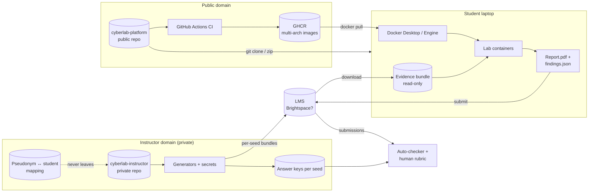
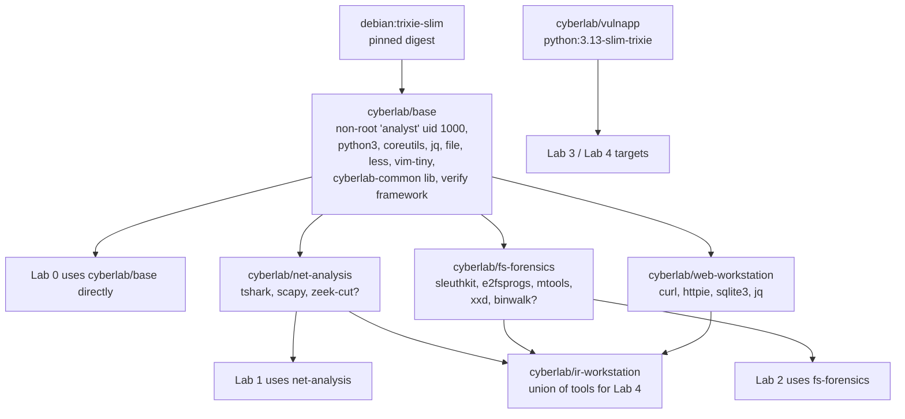
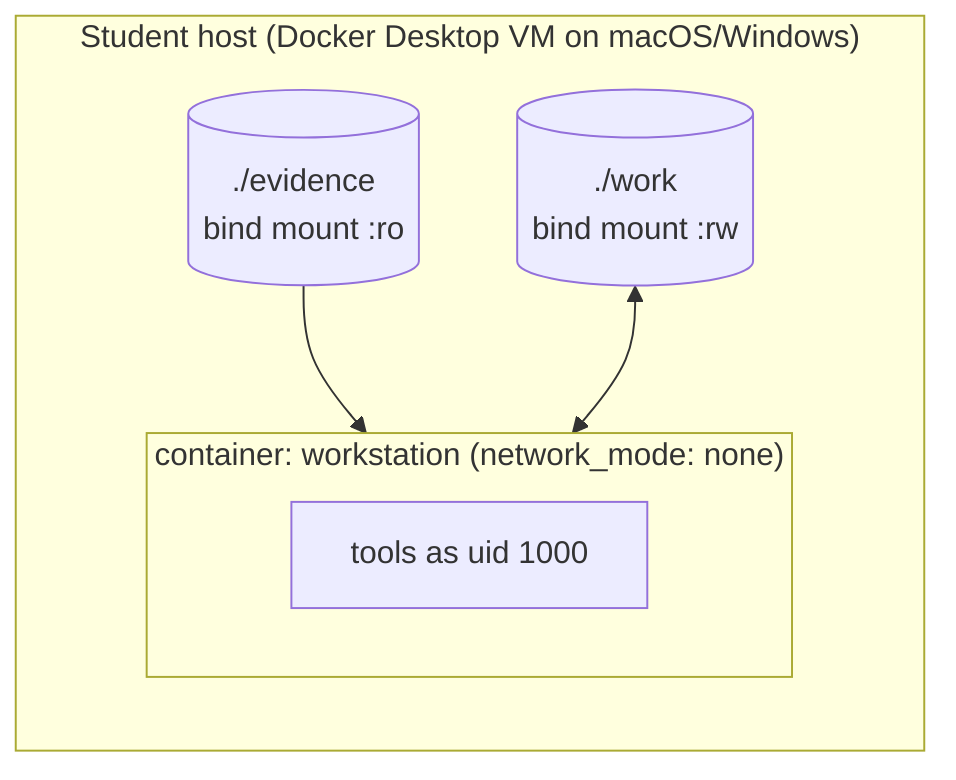
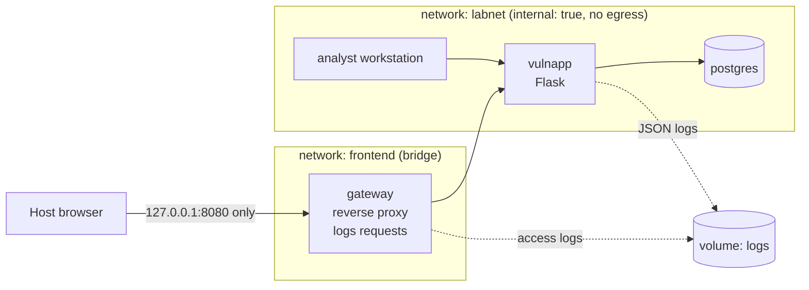
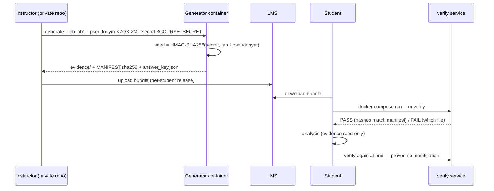

# Initial Technical Architecture

| Field | Value |
|---|---|
| Document ID | CL-P1-ARCH |
| Version | 0.1.0 (Draft) |
| Status | **Proposed** |
| Related ADRs | [0002](../adr/0002-docker-compose-primary-runtime.md) – [0011](../adr/0011-tshark-in-container-wireshark-on-host.md) |

---

## 1. Architectural principles

1. **Docker is the only host dependency.** Every script (verify, reset, generate, grade) runs in a container. No host Python, Bash, or Make is required, which removes the biggest source of Windows breakage. ([ADR-0004](../adr/0004-host-depends-only-on-docker.md))
2. **Evidence is data, tools are images.** Images contain tools; evidence bundles are versioned, hashed artifacts mounted read-only. One image can serve thousands of student variants.
3. **No network unless the lesson needs one.** Analysis labs have no network at all. Service labs use internal-only networks. ([ADR-0006](../adr/0006-network-isolation-patterns.md))
4. **Determinism over realism *where they conflict*,** and an explicit note to students wherever a synthetic artifact differs from real-world behavior.
5. **Write once, specialize per lab.** Shared base image, shared Compose fragments, shared Python library, shared doc templates.
6. **Kubernetes-ready, not Kubernetes-dependent.** Containers follow conventions that translate directly into Pods later, but nothing requires Kubernetes now. ([ADR-0002](../adr/0002-docker-compose-primary-runtime.md))

## 2. System context

**Trust boundaries:** (1) private instructor repo ↔ everything else; (2) student laptop host ↔ lab containers; (3) lab containers ↔ any network.

## 3. Technology stack (candidate versions — pinned in Phase 2)

Versions below were checked against Debian 13 ("trixie") package listings on 2026-10-09 and will be pinned by digest/package version when Lab 1 is implemented.

| Layer | Choice | Candidate version | Rationale |
|---|---|---|---|
| Base OS image | `debian:trixie-slim` | Debian 13 | Multi-arch (amd64/arm64), long support window, forensic tools packaged ([ADR-0005](../adr/0005-base-image-debian-slim-multiarch.md)) |
| Language | Python | 3.13 (Debian 13 system Python) | Generators, verify, auto-checker; one version everywhere |
| Packet tooling | TShark / Wireshark CLI tools | 4.4.x (Debian 13) | Industry standard; same dissectors as Wireshark GUI |
| PCAP generation | Scapy | pinned via `requirements.txt` | Deterministic, scriptable packet crafting ([ADR-0009](../adr/0009-deterministic-pcap-generation-with-scapy.md)) |
| File-system forensics | The Sleuth Kit | 4.12.1 (Debian 13) | `mmls/fsstat/fls/istat/icat/blkls/mactime` |
| Image generation | e2fsprogs (`mkfs.ext4 -d`, `debugfs`), dosfstools + mtools | Debian 13 | Builds images **without root or loop mounts** — feasibility spike passed ([ADR-0008](../adr/0008-userspace-forensic-image-generation.md)) |
| Hashing | `sha256sum` (coreutils), Python `hashlib` | — | Standard, cross-checked |
| Web app (Labs 3–4) | Purpose-built Flask app + PostgreSQL, reverse proxy (Caddy or nginx) | pinned in Phase 3 | Seedable, controlled vulnerabilities, structured JSON logs ([ADR-0010](../adr/0010-purpose-built-vulnerable-web-app.md)) |
| Orchestration | Docker Compose v2 (Compose Specification) | Compose ≥ 2.20 | Present in Docker Desktop and Docker Engine |
| Registry | GitHub Container Registry (GHCR) | — | Free for public images; same identity as repo |
| CI | GitHub Actions; native `ubuntu-24.04-arm` runners for arm64 | — | Free arm64 hosted runners for public repos (GA Aug 2025) avoid slow QEMU builds |
| Testing | `pytest` (inside a test container), Compose-based integration tests, `hadolint`, `trivy` (or Grype) | pinned | Unit + integration + security scanning |
| Docs | Markdown + Mermaid (renders on GitHub); PDF export via Pandoc container | — | No proprietary tooling |

## 4. Image hierarchy

*"?" = evaluate in the lab's phase; added only if a learning objective needs it.*

Tool images are **role-based**, not lab-based, so Lab 4 reuses Lab 1–3 tooling and future labs (e.g., SIEM) add a role image instead of a new stack.

## 5. Runtime topology patterns

### Pattern A — Offline analysis workstation (Labs 0, 1, 2)

- `network_mode: none` — the container has only a loopback interface.
- Evidence: read-only bind mount. Work products: separate writable bind mount, so students can open reports and exported files with host apps (e.g., Wireshark GUI, a PDF viewer).
- Interactive use: `docker compose run --rm workstation` drops into a shell.

### Pattern B — Isolated multi-service lab (Labs 3, 4)

- Containers on an `internal: true` network cannot reach the internet or the host LAN, and Docker will not publish their ports. The gateway is the *only* container attached to both networks and the only published port, bound to `127.0.0.1`.
- Consequence: even a successful SSRF or command-injection in the vulnerable app has **no route out**.
- Gateway logs are themselves lab evidence (Lab 3 log analysis, Lab 4 correlation).

### Pattern C — Evidence pipeline (all labs)

## 6. Seeded variant design

| Element | Design |
|---|---|
| Identifier | Random pseudonym (e.g., `K7QX-2M`, 8 base-32 chars) generated per student per course. Never derived from student ID, name, or email. |
| Seed derivation | `seed = HMAC-SHA256(course_secret, lab_id ‖ generator_major_version ‖ pseudonym)`. Without `course_secret`, knowing a pseudonym does not let anyone regenerate a key. |
| What varies | Indicator values (IPs, domains, ports, filenames, usernames), event timing (within a fixed narrative window), ordering, decoy volume. |
| What stays fixed | Narrative structure, number and type of findings, difficulty, rubric. Every variant must be *equivalently difficult*. |
| Answer key | `answer_key.json` emitted alongside evidence; schema shared with `findings.json`. |
| Mapping storage | Instructor-only CSV (`pseudonym, student`) kept outside Git or encrypted (e.g., `age`/`sops`) — decision in [08-open-decisions.md](08-open-decisions.md). |
| Distribution | **MVP:** a pool of *K* variants (default 8) assigned round-robin, which keeps LMS work manageable. **Full:** one variant per student. Both use the same generator. |
| Public demo | Seed `demo`; evidence and answer key are public for CI and self-study. |

**Why generators are private:** A Lab 1 generator literally contains the C2 domain list. Publishing it during the term would publish the answers. Generators move to a public archive after each term, or a scrubbed reference generator is published for research reproducibility ([ADR-0003](../adr/0003-two-repository-split.md)).

## 7. Per-lab architecture summary

| | Lab 0 | Lab 1 | Lab 2 | Lab 3 | Lab 4 |
|---|---|---|---|---|---|
| Pattern | A | A | A | B | B + A |
| Containers | 1 | 1 (+verify) | 1 (+verify) | gateway, vulnapp, db, workstation | Lab 3 stack (replayed) + IR workstation |
| Network | none | none | none | internal + loopback gateway | internal + loopback gateway |
| Evidence | small sample files | 1–3 PCAPs (≤ 50 MB) | ext4 disk image (≈ 256 MB) + FAT32 USB image (≈ 64 MB) | live app + generated logs | PCAP, JSON app logs, auth logs, disk triage image, DB dump |
| Memory limit (sum) | 256 MB | 512 MB | 768 MB | ≤ 2 GB | ≤ 3 GB |
| Host ports | none | none | none | `127.0.0.1:8080` | `127.0.0.1:8080` (optional) |
| Key tools | sh, sha256sum, file, docker CLI | tshark, capinfos, editcap, python | TSK, xxd, debugfs (read-only) | browser, curl, proxy logs, psql | all of the above + timeline tooling |

Detailed per-lab diagrams, ports, and storage are produced in each lab's own architecture document during Phases 2–3.

## 8. Container vs. virtual machine feasibility

| Workload | Container OK? | Notes |
|---|---|---|
| PCAP analysis (TShark) | ✅ Yes | No capabilities needed when reading files. |
| Live packet **capture** | ⚠️ Partial | Needs `NET_RAW`/`NET_ADMIN`; only inside an internal lab network. Not used in Release 1. |
| Wireshark **GUI** | ⚠️ Host install preferred | A containerized GUI needs X11/VNC (heavy, fragile on macOS/Windows). Use host Wireshark on the shared `work/` folder; TShark is the required path ([ADR-0011](../adr/0011-tshark-in-container-wireshark-on-host.md)). |
| Disk image analysis (TSK) | ✅ Yes | TSK reads images in user space; no mounts needed. |
| **Mounting** images (loop/FUSE) | ❌ Avoid | Requires `SYS_ADMIN` or `/dev/fuse` — breaks least-privilege. Not required by any objective. |
| Generating ext4/FAT images | ✅ Yes (spike-verified) | `mkfs.ext4 -d` + `debugfs`, `mkfs.vfat` + `mtools`; all ran as an unprivileged user. |
| Vulnerable web app | ✅ Yes, with Pattern B | Internal network + loopback-only gateway. |
| Memory **analysis** (Volatility 3) | ✅ Yes | Analysis of supplied images is user-space Python. |
| Memory **acquisition** / generating realistic memory images | ❌ VM required | Needs a running guest kernel (LiME, hypervisor snapshot). Instructor-side only, produced once in a VM. |
| Windows artifact **analysis** (EVTX, registry, prefetch) | ✅ Yes | Python parsers on Linux (e.g., python-evtx, regipy) — to verify. |
| Windows artifact **generation** | ❌ VM required | Needs a licensed Windows VM, instructor-side, done once per scenario. |
| Malware triage — static | ⚠️ Container with no network | Only inert or defanged samples; files stored encrypted at rest. |
| Malware triage — **dynamic** (detonation) | ❌ VM required, off student laptops | Containers share a kernel; escape risk is unacceptable on student hardware. |
| SIEM (e.g., OpenSearch/Wazuh) | ⚠️ Heavy | 2–4 GB RAM for the stack alone; likely exceeds NFR-02 on 8 GB laptops. Candidate for hosted delivery. |

### 8.1 Limits of container isolation (for students and instructors)

- **Shared kernel.** Containers are processes isolated by namespaces and cgroups, not separate machines. A kernel vulnerability can allow escape. On macOS and Windows, Docker Desktop runs containers inside a Linux VM, which adds a VM boundary between containers and the host OS. Containers still share that VM's kernel with one another.
- **The `docker` group is root-equivalent** on Linux hosts. Students on Linux should prefer rootless Docker or Docker Desktop for Linux; this is documented, not enforced.
- **Bind mounts are host access.** Only `./evidence` (read-only) and `./work` are mounted. Never the home directory, never `/var/run/docker.sock`.
- **Default seccomp/AppArmor profiles are kept on** — never `unconfined`.
- **When a VM is mandatory:** executing real malware, kernel-level acquisition, any workload needing `privileged` or `SYS_ADMIN`, non-Linux guest operating systems, or untrusted code that must touch hardware.

## 9. Access tiers for students who cannot run Docker locally

| Tier | Mechanism | Status | Caveats |
|---|---|---|---|
| 1 | Local Docker Desktop / Engine | Primary | Needs admin rights and virtualization support once. |
| 2 | Browser-hosted dev container (GitHub Codespaces from repo's `.devcontainer/`) | Designed in Week 1, tested in Week 4 | Requires a GitHub account; free monthly quota and GitHub Education benefits **must be verified** before relying on it; ports must remain private. |
| 3 | Department-hosted Docker host or campus lab machines | Requires IT engagement | Multi-user isolation is the hard part (see Phase 5). |
| 4 | Cloud (AWS) per-student environments | Phase 5 study only | Not deployed without written authorization and budget. |

## 10. Kubernetes-readiness rules (applied now, at no extra cost)

1. One process per container; health checks defined in Compose (`healthcheck:`) mirror future readiness probes.
2. Configuration via environment variables and mounted files only.
3. Images are immutable and stateless; state lives in named volumes or bind mounts.
4. Resource limits declared in Compose (`deploy.resources.limits` / `mem_limit`, `cpus`, `pids_limit`) map 1:1 to Pod limits.
5. Non-root, read-only root FS, dropped capabilities — these already satisfy the Kubernetes **Restricted** Pod Security Standard.
6. Network isolation expressed as named networks, later rewritten as `NetworkPolicy` (default-deny egress).
7. No reliance on Compose-only features such as `extends` across labs at runtime; shared Compose fragments are resolved at build time.

## 11. Cross-platform specifics

| Issue | Mitigation |
|---|---|
| Windows CRLF line endings break shell scripts | `.gitattributes` forces `eol=lf`; scripts live in images, not on the host. |
| Windows path and bind-mount quirks | Use relative paths in Compose; recommend cloning inside the WSL 2 filesystem; document clearly. |
| Apple Silicon running amd64-only images (slow emulation) | Every image built natively for arm64; CI fails if an arch is missing. |
| Docker Desktop VM memory defaults too low or too high | Lab 0 shows students how to check and set VM memory (target 4 GB). |
| Corporate/campus proxies | Document `docker pull` proxy settings; offer offline image tarballs (`docker save`) as a fallback. |
| Docker Hub pull rate limits | Students pull from GHCR, not Docker Hub. |
