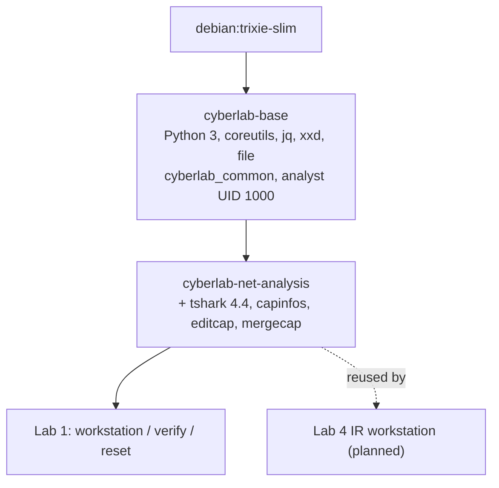
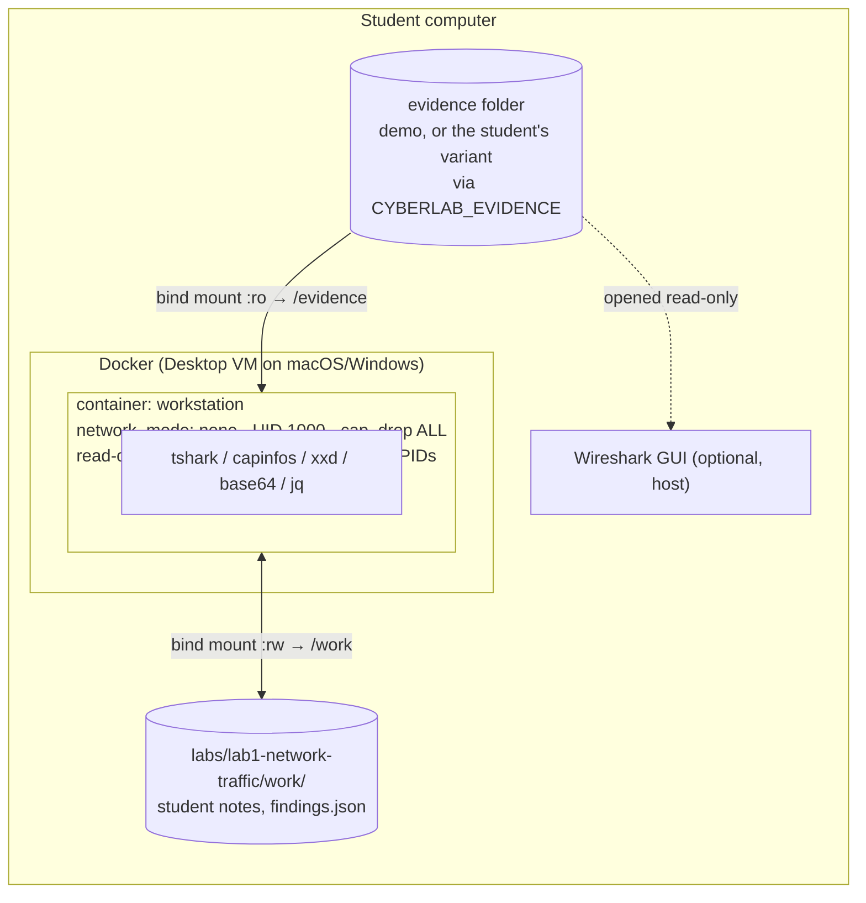
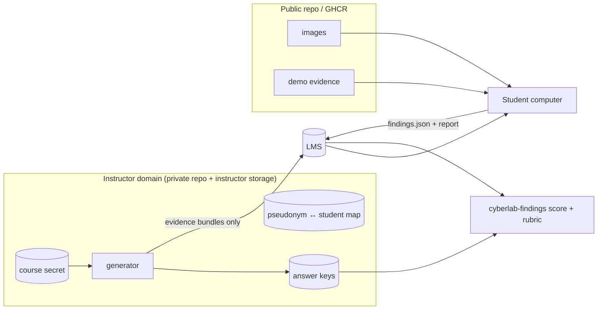
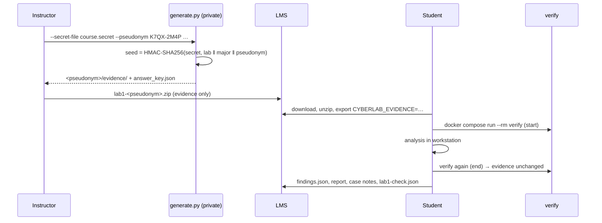

# Lab 1 — Architecture

> **Status:** Draft v0.1.0 (2026-11-17). Image build and `verify` tested on macOS Apple Silicon (Docker Desktop, TShark 4.4.19). The integration test (`tests/integration.sh`) and the CI/release jobs for this lab are new and **UNTESTED** on GitHub Actions. Resource figures marked *(CI)* are filled in from the CI job summary after the first run.

Lab 1 uses **Pattern A** (offline analysis workstation) from the platform architecture ([`docs/phase-1/02-architecture.md` §5](../../../docs/phase-1/02-architecture.md)). This document records what is specific to Lab 1.

## 1. Components

| Component | What it is | Where it lives |
|---|---|---|
| `cyberlab-net-analysis` image | `cyberlab-base` + TShark, capinfos, editcap, mergecap, dumpcap (setuid disabled) | `platform/images/net-analysis/Dockerfile`, published to `ghcr.io/kernalguard/cyberlab-net-analysis:<version>` |
| `workstation` service | Interactive analyst shell | `compose.yaml` |
| `verify` service | Environment, integrity and isolation checks (`cyberlab-verify` with `lab.yaml`) | `compose.yaml`, `lab.yaml` |
| `reset` service | Restores `work/` from `work.template/`, backing up previous work | `compose.yaml` |
| Demo evidence | `cedarwick-ws-segment.pcapng` (≈ 17 MB, ≈ 20 k frames, 1 h), `CASE-BRIEF.txt`, `MANIFEST.sha256` | `evidence/` (public) |
| Student variants | Same three files per pseudonym, different indicators | Generated privately, released through the LMS |
| Generator, reference solution, answer keys | Scapy generator (deterministic per seed), TShark-only solver | Private instructor repository (ADR-0003) |
| Checker | `cyberlab-findings validate` (students) / `score` (instructors) | `cyberlab_common.findings`, in every image |

## 2. Image hierarchy

The release workflow builds `cyberlab-net-analysis` **from the base image of the same version** (`BASE_IMAGE=ghcr.io/<owner>/cyberlab-base:<version>`), natively for linux/amd64 and linux/arm64. Local builds (`docker compose build workstation`) use the Dockerfile's default base tag.

## 3. Runtime topology

There is **no network, no published port and no capture interface**. TShark only reads files. `dumpcap` is installed as a dependency of TShark but has no setuid bit and no capabilities, so live capture fails (asserted by the integration test).

## 4. Storage and mounts

| Path in container | Source | Mode | Contents |
|---|---|---|---|
| `/evidence` | `${CYBERLAB_EVIDENCE:-./evidence}` | **read-only** | Capture, case brief, manifest |
| `/work` | `./work` | read-write | Student notes, `findings.json`, `lab1-check.json`, exports (`upload-decoded.txt` …) |
| `/lab/lab.yaml` | `./lab.yaml` | read-only | Verify checks, objectives |
| `/lab/work.template` | `./work.template` | read-only | Templates restored by `reset` |
| `/tmp` | tmpfs | read-write, 64 MB | Scratch for tools |
| everything else | image | read-only | Root filesystem |

`work/` is git-ignored except `.gitkeep`, so student work is never committed.

## 5. Trust boundaries

1. **Private ↔ public.** Generators, keys, the course secret and the roster never enter the public repository or any image. The leak test (`tests/leaks/`) fails CI on answer-key files or secrets. The demo answer key stays private (open decision OD-15).
2. **Host ↔ container.** Only `evidence/` (read-only) and `work/` are shared. No Docker socket, no home directory.
3. **Container ↔ network.** None. Indicators in the evidence are reserved names and documentation/private addresses, and students are told not to look them up.

## 6. Resources

| Resource | Limit | Measured |
|---|---|---|
| Memory | 512 MB (`mem_limit`) | Peak during a full analysis pass: *(CI, AC-L1-09 requires < 512 MB)* |
| CPU | 1.0 | — |
| PIDs | 128 | — |
| Disk | Image *(CI; target ≤ 350 MB compressed, AC-P-02)* + evidence ≈ 17 MB + work files < 5 MB | macOS build 2026-11-17: built successfully |
| Startup | — | `run true` < 10 s after build (AC-L1-08, asserted by the integration test) |

Each TShark command re-reads the whole capture. On a 1-CPU limit, statistics commands take a few seconds; this is noted in the student troubleshooting table.

## 7. Evidence pipeline

The generator is byte-reproducible for a given seed, Python minor version and Scapy version. Variants are generated once per term on one machine and archived.

## 8. Security controls and how they are tested

| Requirement | Control | Test |
|---|---|---|
| SEC-01 | No privileged mode, host network/PID or Docker socket | `tests/policy/test_compose_policy.py` |
| SEC-02 | UID 1000, `cap_drop: ALL`, `no-new-privileges` | policy test; `verify`; integration test (`id -u`) |
| SEC-03 | Read-only root FS, tmpfs `/tmp` | integration test (write to `/usr/local/bin` fails) |
| SEC-04 | `network_mode: none` | `verify` network-isolation; integration test (only `lo` up) |
| SEC-07 | Memory, CPU, PID limits | policy test; integration test (peak memory) |
| SEC-09 | No instructor material in public repo/images | `tests/leaks/` |
| FR-E-04 | Evidence read-only | `verify`; integration test |
| FR-E-05 | Integrity before and after | `verify`; integration test (hashes after a full analysis pass) |
| — | No live capture | integration test (`dumpcap` refused) |

## 9. Acceptance criteria coverage

| Criterion | Where checked | Status |
|---|---|---|
| AC-L1-01 reproducible, AC-L1-02 distinct variants, AC-L1-03 solvable, AC-L1-12 checker | Instructor repo `generators/lab1/tests/acceptance.py` | PASS (Linux, 10 seeds, 2026-11-13) |
| AC-L1-04 parses cleanly | acceptance test; integration test | PASS (acceptance); integration *(CI)* |
| AC-L1-05 integrity, AC-L1-06 immutability, AC-L1-07 no network | `verify`; integration test | `verify` PASS on macOS 2026-11-17 |
| AC-L1-08 startup, AC-L1-09 memory, AC-L1-10 reset, AC-L1-11 teardown | integration test | *(CI)* |
| AC-L1-13 guide sections | `tests/docs/` | PASS |
| AC-L1-14 objectives traced, AC-L1-15 rubric | Student guide §5; instructor rubric traceability table | Drafted, awaiting review |
| AC-L1-16 completion time, AC-L1-17 cross-platform walkthrough | Peer walkthrough | Not yet done |

## 10. Synthetic vs real

Students are told (guide §6) where the capture is simplified. For maintainers:

- One hour, one segment, about ten hosts. Real exports are larger and include broadcast noise from many more device types.
- The C2 channel is plain HTTP so the content is readable. Real implants mostly use TLS; only metadata (SNI, JA3/JA4, timing, sizes) would be visible.
- The upload is base64 CSV of fictional records. Real exfiltration is usually compressed and/or encrypted.
- TLS sessions are synthetic handshakes plus opaque records; they do not decrypt to anything.
- Timing is generated (intervals with bounded jitter) and deterministic per seed.

## 11. Kubernetes mapping (future)

| Compose | Kubernetes |
|---|---|
| `workstation` with `network_mode: none` | Pod with a default-deny `NetworkPolicy` (ingress and egress) |
| UID 1000, `cap_drop: ALL`, `no-new-privileges`, read-only root | `securityContext`, satisfies the **Restricted** Pod Security Standard |
| `mem_limit`, `cpus`, `pids_limit` | `resources.limits`; PID limit at the node/runtime level |
| `/evidence` read-only bind mount | Read-only volume (ConfigMap is too small; use a PVC or an init container that fetches the bundle) |
| `/work` bind mount | Per-student PVC |
| `verify` / `reset` | Jobs, or commands in the same Pod |
