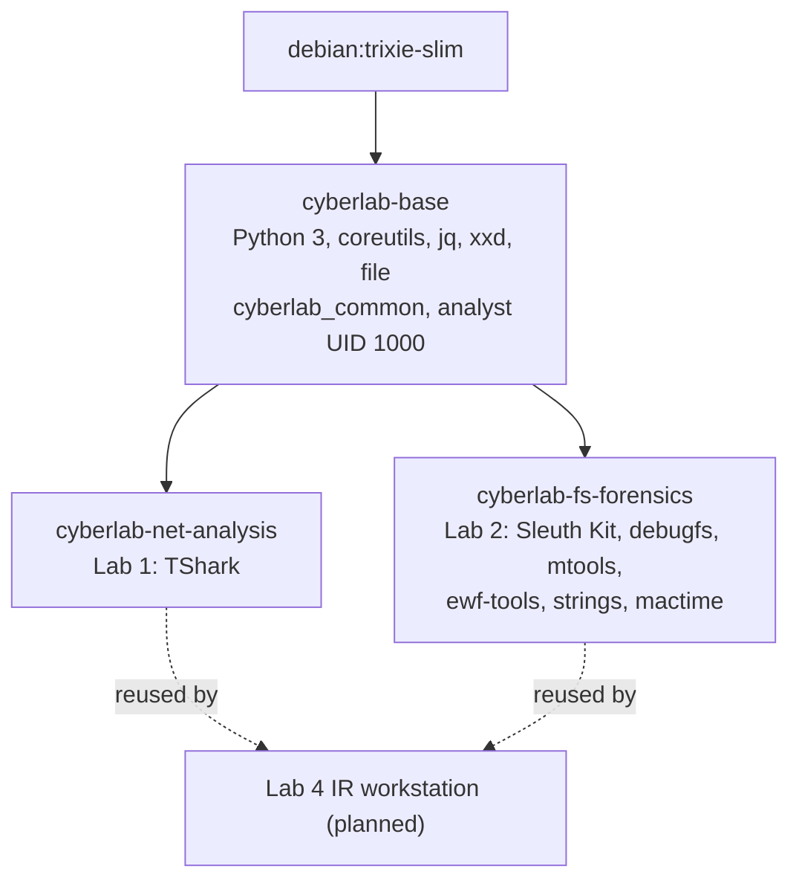
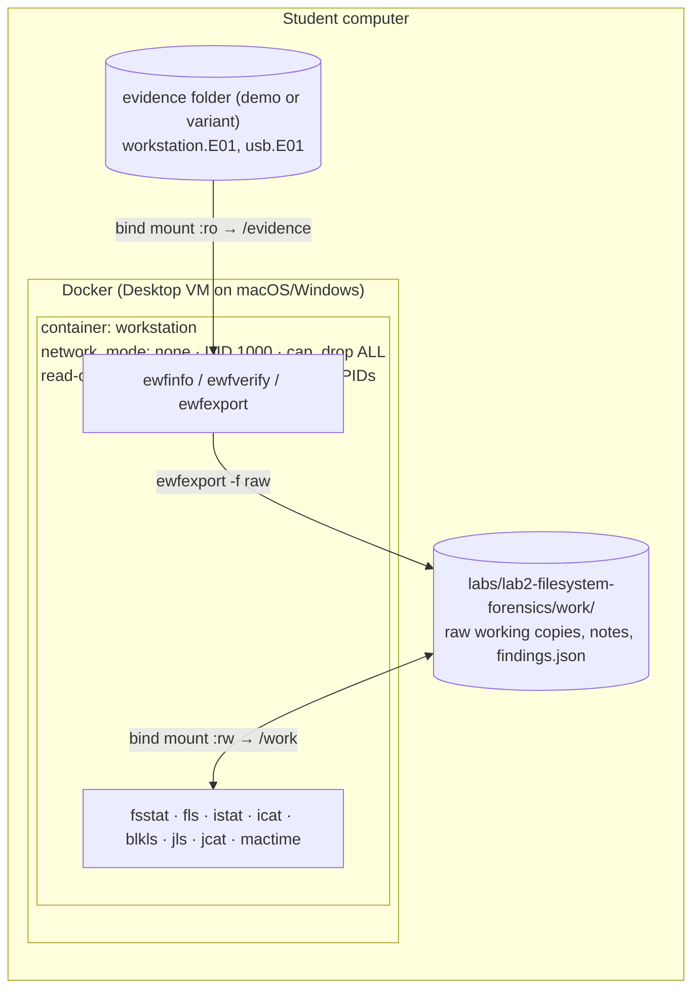
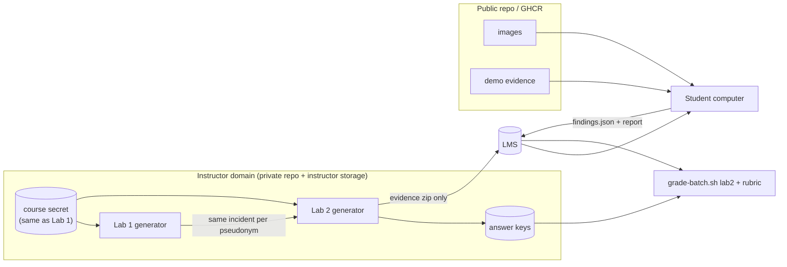
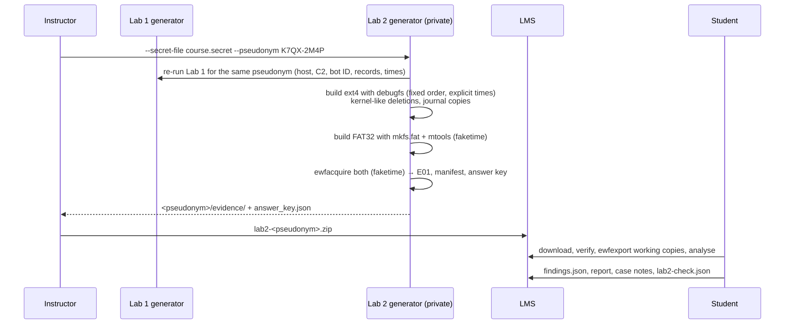

# Lab 2 — Architecture

> **Status:** Draft v0.3.0 (2026-11-17). Image build, `verify` and the student workflow tested on macOS Apple Silicon (Docker Desktop, Sleuth Kit 4.12.1, libewf 20140816). The integration test (`tests/integration.sh`) and the CI and release jobs for this lab are new and **UNTESTED** on GitHub Actions. Figures marked *(CI)* come from the first CI run. Windows: **UNTESTED**.

Lab 2 uses **Pattern A** (offline analysis workstation) from the platform architecture ([`docs/phase-1/02-architecture.md` §5](../../../docs/phase-1/02-architecture.md)), like Lab 1. This document records what is specific to Lab 2.

## 1. Components

| Component | What it is | Where it lives |
|---|---|---|
| `cyberlab-fs-forensics` image | `cyberlab-base` + The Sleuth Kit 4.12, e2fsprogs (debugfs), mtools, libewf tools, binutils (`strings`), Perl (`mactime`) | `platform/images/fs-forensics/Dockerfile` → `ghcr.io/kernalguard/cyberlab-fs-forensics:<version>` |
| `workstation` / `verify` / `reset` services | Analyst shell; environment, integrity and isolation checks; template restore | `compose.yaml`, `lab.yaml` |
| Demo evidence | `workstation.E01` (ext4, 128 MiB raw), `usb.E01` (FAT32, 64 MiB raw), `CASE-BRIEF.txt`, `MANIFEST.sha256`; ≈ 390 KB | `evidence/` (public; continues the Lab 1 demo incident) |
| Student variants | Same files per pseudonym; each continues that student's Lab 1 variant | Generated privately, released through the LMS |
| Generator, reference solution, answer keys | `generate.py` + `ext4lib.py` (debugfs, mtools, ewfacquire, faketime); TSK-only solver | Private instructor repository (ADR-0003) |

## 2. Image hierarchy

The release workflow builds `net-analysis` and `fs-forensics` in parallel, each **from the base image of the same version**, natively for linux/amd64 and linux/arm64.

## 3. Runtime topology and the working-copy workflow

1. `ewfinfo`/`ewfverify` read the E01 containers (acquisition metadata, stored MD5).
2. `ewfexport -f raw` writes **working copies** into `/work`; students confirm each copy's MD5 equals the MD5 stored in the E01.
3. Sleuth Kit runs on the raw copies only.

**Why not Sleuth Kit on the E01 directly?** With Debian 13's libewf 20140816, every TSK tool prints correct output from an E01 and then **segfaults on exit** (status 139), found on macOS Apple Silicon 2026-11-17. Raw images are unaffected. Working copies are also standard examiner practice, so the workaround doubles as a lesson. `/tmp` is a 64 MB tmpfs and is too small for the 128 MiB copy, so exports go to `/work`.

Nothing is mounted: no loop devices, no FUSE (`ewfmount` is not used), and `mount` fails for the unprivileged user (asserted by the integration test).

## 4. Storage and mounts

| Path in container | Source | Mode | Contents |
|---|---|---|---|
| `/evidence` | `${CYBERLAB_EVIDENCE:-./evidence}` | **read-only** | E01 files, case brief, manifest |
| `/work` | `./work` | read-write | Raw working copies (≈ 192 MB), `unalloc.bin`, notes, `findings.json`, `lab2-check.json` |
| `/lab/lab.yaml`, `/lab/work.template` | lab folder | read-only | Verify checks, templates |
| `/tmp` | tmpfs | read-write, 64 MB | Scratch |
| everything else | image | read-only | Root filesystem |

`verify` requires ≥ 1 GB free disk (warns below 3 GB) for the working copies.

## 5. Trust boundaries

1. **Private ↔ public:** generators, keys, secret and roster never enter the public repo or images (leak test).
2. **Host ↔ container:** only `evidence/` (read-only) and `work/` are shared.
3. **Container ↔ network:** none.
4. **Evidence content:** all synthetic. The "installer" and "implant" are text with every command commented out (SEC-08); nothing in the evidence is executable in a meaningful way, and the guide never asks students to run it.

## 6. Resources

| Resource | Limit | Measured |
|---|---|---|
| Memory | 768 MB | Peak during an analysis pass: *(CI)* |
| CPU / PIDs | 1.0 / 128 | — |
| Disk | Image *(CI)* + evidence < 1 MB + working copies ≈ 192 MB + `unalloc.bin` ≈ 120 MB | macOS build 2026-11-17: OK |
| Startup | — | `run true` < 10 s (integration test) |

## 7. Evidence pipeline

Byte-reproducible for a given seed and tool versions (e2fsprogs, mtools, libewf, Python). Generate once per term on one machine and archive.

## 8. Security controls and how they are tested

| Requirement | Control | Test |
|---|---|---|
| SEC-01/02 | No privileged mode; UID 1000; `cap_drop: ALL`; `no-new-privileges` | `tests/policy/`; `verify`; integration test |
| SEC-03 | Read-only root FS, tmpfs `/tmp` | integration test |
| SEC-04 | `network_mode: none` | `verify`; integration test |
| SEC-07 | Memory, CPU, PID limits | policy test; integration test (peak memory) |
| SEC-08 | Inert synthetic "malware" (commented-out text) | generator code review; instructor answer key |
| SEC-09 | No instructor material in public repo/images | `tests/leaks/` |
| ADR-0008 | No mounting | integration test (`mount` refused) |
| FR-E-04/05 | Evidence read-only; integrity before and after | `verify`; integration test |

## 9. Acceptance criteria coverage

| Criterion | Where checked | Status |
|---|---|---|
| AC-L2-01 reproducible, AC-L2-02 distinct variants, AC-L2-03 solvable (reference 100%, blank 0, wrong variant flagged), AC-L2-04 ewfverify + fsck, AC-L2-05 Lab 1 continuity | Instructor repo `generators/lab2/tests/acceptance.py` | PASS (Linux x86-64, 10 seeds, 2026-11-17) |
| Working copies match E01 MD5; TSK on raw exits 0; orphans, FAT deleted entry, journal copies, carving, mactime | integration test | PASS on macOS by hand 2026-11-17; integration *(CI)* |
| Integrity, read-only, no network, startup, memory, reset, teardown | `verify`; integration test | `verify` PASS on macOS; rest *(CI)* |
| Guide sections, objectives | `tests/docs/` | PASS |
| Rubric, traceability | Instructor `labs/lab2/rubric.md` | Drafted, awaiting review |
| Completion time, cross-platform walkthrough | Peer walkthrough | Not yet done |

## 10. Synthetic vs real

- Small disks containing only the relevant user files; no operating system, packages or browser profiles.
- Deletion matches the observed Linux 6.x behaviour (directory entry and extent map wiped, data intact). Older kernels left the name; a busy system would overwrite freed blocks sooner.
- The journal holds only the incident's transactions (one block per transaction, so Sleuth Kit 4.12 `jls` lists them correctly; real journals batch many blocks per transaction).
- Logs are short excerpts in Ubuntu 24.04's RFC 3339 format.
- Timestamps have whole-second precision (`*_extra` nanosecond fields are zero); real ext4 timestamps carry nanoseconds.
- E01 acquisition is simulated (`ewfacquire` on the generated raw image under a fixed clock); the "write blocker" is narrative.

## 11. Kubernetes mapping (future)

Same as Lab 1 (Pod with default-deny `NetworkPolicy`, Restricted security context, resource limits, read-only evidence volume, per-student PVC for `/work`). Lab 2 needs a larger `/work` volume (≥ 512 MB) for the working copies.
