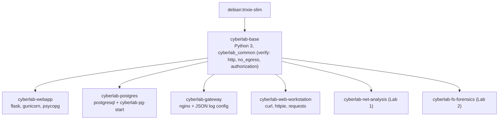
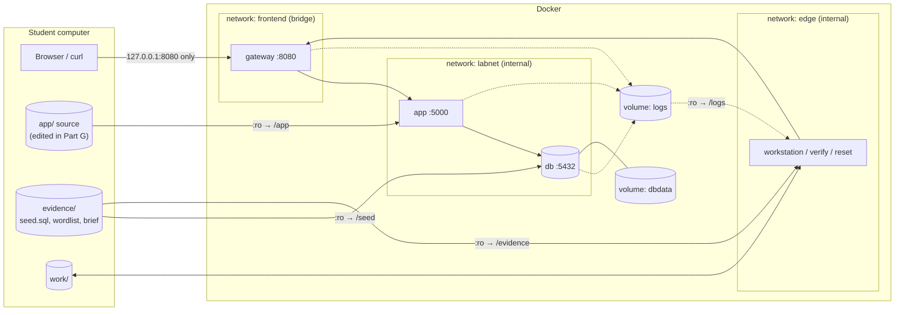
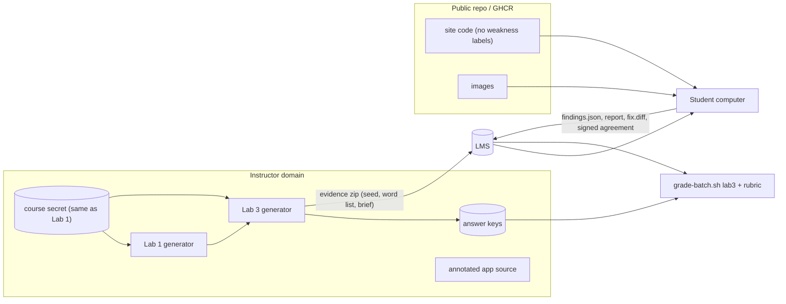
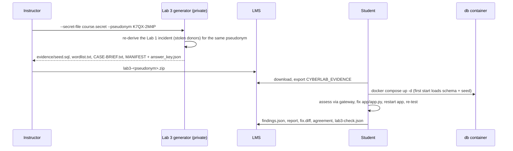

# Lab 3 — Architecture

> **Status:** Draft v0.4.0 (2026-11-18). The stack was built and tested on macOS Apple Silicon (Docker Desktop): services healthy, `verify` 14/14, the integration test (`tests/integration.sh`, 36 checks) passing, and the HTTP reference solution scoring 40/40 against the containers. CI runs the integration test on linux/amd64 and linux/arm64 from this version. Figures marked *(CI)* come from the CI job summary. Windows: **UNTESTED**.

Lab 3 is the first **Pattern B** lab (isolated multi-service; [`docs/phase-1/02-architecture.md` §5](../../../docs/phase-1/02-architecture.md), ADR-0006): several cooperating containers on internal networks, with one gateway reachable only from the student's own computer. The application is purpose-built and intentionally vulnerable (ADR-0010).

## 1. Components

| Service | Image | Role |
|---|---|---|
| `gateway` | `cyberlab-gateway` (Debian nginx) | The only entry point. Reverse proxy to the app; JSON access log including the session cookie (`/logs/gateway.jsonl`). |
| `app` | `cyberlab-webapp` (Debian Flask, gunicorn, psycopg) | The Cedarwick donation site. Code bind-mounted read-only from `app/` so students can patch it on the host (Part G). JSON application log (`/logs/app.jsonl`). |
| `db` | `cyberlab-postgres` (Debian PostgreSQL) | Created on first start from `db/schema.sql` + the variant's `seed.sql`; logs every statement (`/logs/postgres.log`). |
| `workstation`, `verify`, `reset` | `cyberlab-web-workstation` (curl, HTTPie, Python requests) | Assessment shell and checks; profile `tools`, started on demand. |

All four images are built FROM `cyberlab-base` of the same version and published to GHCR for linux/amd64 and linux/arm64; nothing is pulled from Docker Hub at lab time.

## 2. Image hierarchy

## 3. Runtime topology

The gateway joins all three networks; it is the only container on `frontend`, which exists solely so Docker can publish `127.0.0.1:8080`. `edge` and `labnet` are `internal: true`: no default route, no internet.

### Reachability (asserted by `tests/integration.sh` and `verify`)

| From \ To | Internet | gateway | app | db | Host 127.0.0.1:8080 |
|---|---|---|---|---|---|
| Student's computer | — | via 127.0.0.1:8080 | ✗ | ✗ | ✓ |
| workstation | ✗ (`verify` egress-blocked) | ✓ (`http:site`) | ✗ | ✗ | — |
| app | ✗ | — | — | ✓ | — |
| db | ✗ | — | — | — | — |
| Other machines on the LAN | — | ✗ (loopback binding) | ✗ | ✗ | ✗ |

## 4. Storage and mounts

| Container path | Source | Mode | Contents |
|---|---|---|---|
| app `/app` | `./app` | read-only | Site code (students edit on the host, then `docker compose restart app`) |
| db `/var/lib/cyberlab/pgdata` | volume `dbdata` | read-write | Database files (`docker compose down -v` deletes them) |
| db `/seed`, `/schema/schema.sql` | evidence, `./db/schema.sql` | read-only | Loaded once, on first start |
| gateway, app, db `/logs` | volume `logs` | read-write | `gateway.jsonl`, `app.jsonl`, `postgres.log` |
| workstation `/logs` | volume `logs` | **read-only** | Part F log analysis |
| workstation `/evidence`, `/work` | evidence, `./work` | ro / rw | Case brief, word list; notes, findings, agreement |
| all `/tmp` | tmpfs 64 MB | rw | Sockets (PostgreSQL), nginx temp files, gunicorn worker files |
| everything else | image | read-only | Root filesystems |

## 5. Trust boundaries and safety controls

| Control | Implementation | Test |
|---|---|---|
| Loopback-only exposure (SEC-05/06) | `ports: "127.0.0.1:8080:8080"` | policy test (`host_ip` = 127.0.0.1); integration test (`docker compose port`) |
| No egress from lab containers | `internal: true` networks | `verify` egress-blocked; integration test (app, db) |
| Workstation reaches only the gateway | workstation on `edge` only | integration test (app and db unreachable) |
| Non-root, no capabilities, read-only root (SEC-01/02/03) | `networked-service` baseline; UID 1000 | policy tests; integration test (all three services) |
| Resource limits (SEC-07) | db 512 MB, app 384 MB, gateway 128 MB, tools 256 MB; 1 CPU, PID limits | policy test; integration test (stack < 2 GB) |
| Authorised use (SEC-11) | `work/authorized-use.md` must be signed (name + `I AGREE`) | `verify` authorized-use; integration test (unsigned refused) |
| No answers in public material (SEC-09) | Weakness labels only in the private annotated copy; seeds private | leak test; review |
| Lint does not flag the training app | ruff security rules exempted for `labs/lab3-webapp-assessment/app/` only | CI lint |

## 6. Resources

| Resource | Limit | Measured |
|---|---|---|
| Memory (whole stack) | 1.28 GB (sum of limits) | 122 MB after the weakness checks (macOS, 2026-11-18); < 2 GB asserted by the integration test |
| Images | — | four images on the shared base *(CI)* |
| Startup | — | healthy in about 20 s (macOS, first start includes database creation and seed load) |
| Evidence | — | ≈ 80 KB per variant |

## 7. Evidence pipeline

Seeds are byte-reproducible for a given pseudonym and generator version.

## 8. Acceptance criteria coverage

| Criterion | Where checked | Status |
|---|---|---|
| AC-L3-01 reproducible, AC-L3-02 distinct variants, AC-L3-03 solvable over HTTP (100%, blank 0, wrong variant flagged), AC-L3-05 Lab 1 continuity | `generators/lab3/tests/acceptance.py` (private) | PASS, 10 seeds (cloud, PostgreSQL 16) |
| Reference solution against the real containers | manual, macOS | PASS 40/40 (2026-11-18) |
| Isolation, hardening, weaknesses present, logs, memory, restart, reset, teardown | `tests/integration.sh` | PASS macOS 2026-11-18; CI amd64 + arm64 *(CI)* |
| Compose security policy | `tests/policy/` | PASS (CI) |
| Guide sections, objectives | `tests/docs/` | PASS |
| Rubric, traceability | instructor `labs/lab3/rubric.md` | Drafted |
| Completion time, cross-platform walkthrough | peer walkthrough | Not yet done |

## 9. Synthetic vs real

- One small application with five deliberate weaknesses, each easy to reach; real applications hide issues behind more code and JavaScript.
- The session design (unsigned base64 JSON) is deliberately naive; real-world session flaws are usually subtler (weak signing keys, missing expiry, fixation).
- Logs are complete and in one volume; real deployments spread them across systems with retention gaps.
- No WAF, rate limiting or monitoring: students are never blocked, so the rules of engagement do the limiting.
- No real payments; card numbers are free text and only the last four digits are stored.

## 10. Kubernetes mapping (future)

| Compose | Kubernetes |
|---|---|
| `labnet`, `edge` (`internal: true`) | Namespace with default-deny egress `NetworkPolicy`; allow app → db:5432, gateway → app:5000, workstation → gateway:8080 |
| gateway on `127.0.0.1:8080` | `Service` of type ClusterIP + `kubectl port-forward` per student (never a LoadBalancer or public Ingress) |
| `dbdata` volume | PVC per student namespace |
| `logs` volume | Shared PVC or a sidecar shipping to per-student storage |
| `app/` bind mount (editable) | Hard to replicate safely; a per-student code PVC or a web IDE would be needed for Part G |
| `verify` checks | Job in the namespace |
