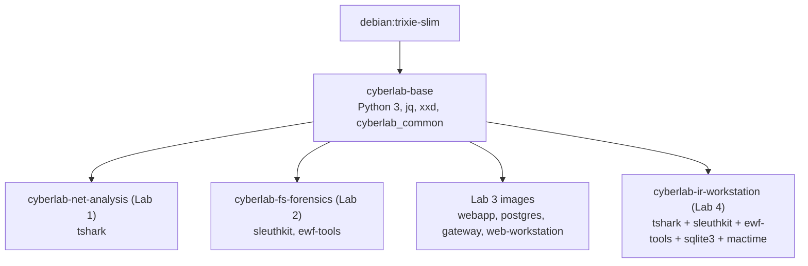
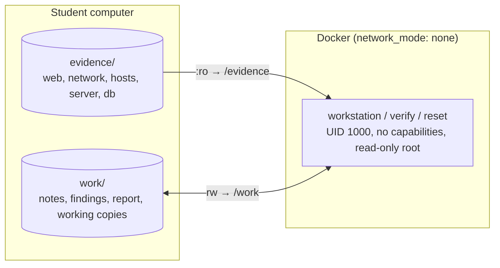
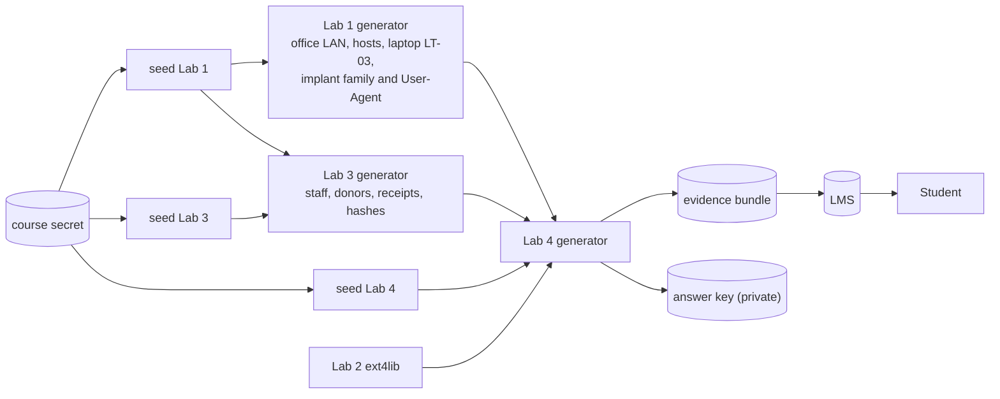
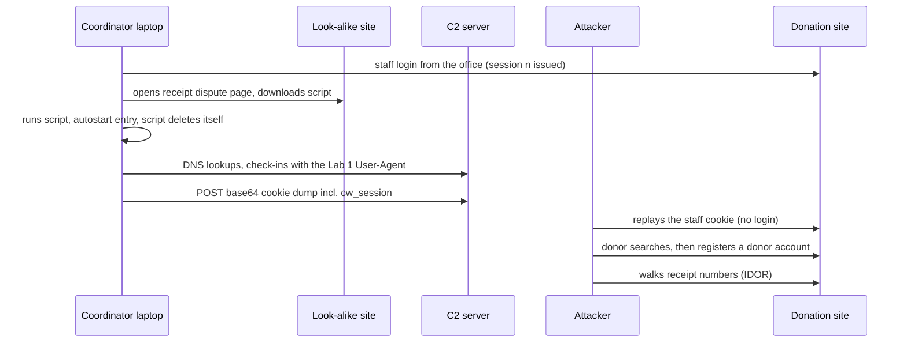

# Lab 4 — Architecture

> **Status:** Draft v0.5.0-dev (2026-11-18). The image was built and checked on macOS Apple Silicon (Docker Desktop): `verify` 10/10 and the instructor reference solution scoring 40/40 inside the container on the demo evidence. The integration test (`tests/integration.sh`) and its CI job are new in this version and not yet run. Figures marked *(CI)* come from the CI job summary once it runs. Windows: **UNTESTED**.

Lab 4 is a **Pattern A** lab ([`docs/phase-1/02-architecture.md` §5](../../../docs/phase-1/02-architecture.md), ADR-0006): one offline analysis container, read-only evidence, no network. The Phase 1 plan allowed a replayed Lab 3 stack (Pattern B + A); the evidence-only design was chosen on 2026-11-18 because the investigation needs the site's *records*, not the running site, and it halves the memory and moving parts.

## 1. Components

| Service | Image | Role |
|---|---|---|
| `workstation` | `cyberlab-ir-workstation` | Analyst shell: TShark, The Sleuth Kit, libewf tools, sqlite3, jq, mactime, Python 3 |
| `verify` | same | Environment, evidence integrity, isolation and hardening checks |
| `reset` | same | Restores `work/` from `work.template/` (backs up first) |

`cyberlab-ir-workstation` is a **role image** (the union of the Lab 1 and Lab 2 analysis tools plus sqlite3), built FROM `cyberlab-base` of the same version and published for linux/amd64 and linux/arm64.

## 2. Image hierarchy

## 3. Runtime topology

| Container path | Source | Mode | Contents |
|---|---|---|---|
| `/evidence` | `${CYBERLAB_EVIDENCE:-./evidence}` | read-only | The bundle (8 files + manifest) |
| `/work` | `./work` | read-write | Raw working copy of the laptop image (64 MB), extracted databases, notes, findings, report |
| `/lab/lab.yaml`, `/lab/work.template` | lab folder | read-only | verify configuration, templates |
| `/tmp` | tmpfs 64 MB | rw | Scratch only — too small for the working copy, which is why the guide exports to `/work` |
| everything else | image | read-only | Root filesystem |

## 4. Evidence bundle

| File | Format | Built from | Students use |
|---|---|---|---|
| `web/gateway.jsonl` | nginx JSON access log (Lab 3 format, includes `session`) | simulated requests against a model of the relaunched Lab 3 app | jq |
| `web/app.jsonl` | Flask JSON events (Lab 3 format) | same simulation | jq |
| `web/postgres.log` | PostgreSQL `log_statement=all`, parameterised (`execute <unnamed>` + `DETAIL: parameters`) | same simulation; format checked against PostgreSQL 16 | grep |
| `network/office-edge.pcapng` | 90-minute capture at the office firewall | Lab 1 generator's office network and traffic code | tshark |
| `hosts/coordinator-laptop.E01` | EnCase 6, ext4, 64 MiB | Lab 2 `ext4lib` (kernel-style deletion) + SQLite Firefox databases | ewfexport, TSK, sqlite3 |
| `server/auth.log` | rsyslog RFC 3339 | generator | grep |
| `db/snapshot.sql` | `pg_dump --inserts` style | Lab 3 seed data + activity in the log window | grep, Python |
| `CASE-BRIEF.txt`, `MANIFEST.sha256` | text | generator | — |

About 15 MB per variant (demo committed in the repository).

## 5. Evidence pipeline and continuity

The Lab 4 generator **re-runs the Lab 1 and Lab 3 generators** for the same pseudonym, so each student's breach involves their own office network, their own staff and donors, and the implant family they met in Labs 1 and 2. Acceptance test AC-L4-05 checks this.

## 6. Incident model (ground truth, simplified)

Look-alikes in the same window: the authorised re-test (listed account, separate address), the Finance Manager's export from home (normal login), internet SSH brute force against the web server (all failed).

## 7. Cross-source consistency

Correlation is the point of the lab, so the generator guarantees that independent sources agree, and the acceptance test checks it (AC-L4-04):

| Event | Sources that must agree |
|---|---|
| Script download | Firefox history visit time = capture GET time (1 s); deleted file's crtime within 5 s after |
| Execution and persistence | `.bash_history` time ≤ `.desktop` crtime ≤ first C2 DNS query |
| Cookie theft | staging file crtime < upload POST; the same cookie in the capture, `cookies.sqlite` and the gateway log |
| Session use | staff login < upload < attacker's first request |
| Every app event | a gateway record for the same client and path within 1 s |
| Attacker registration | app log time = snapshot `created_at` (1 s) |
| Office activity on the site | none inside the capture window, which would otherwise need matching TLS in the capture (generator rule, not yet an acceptance check) |

## 8. Safety controls

| Control | Implementation | Test |
|---|---|---|
| No network (SEC-05) | `network_mode: none` (offline-analyst baseline) | verify `network-isolation`; integration test |
| Non-root, no capabilities, read-only root (SEC-01/02/03) | security baseline; UID 1000 | policy tests; verify; integration test |
| Evidence read-only, unchanged (SEC-04) | `:ro` mount; manifest | verify; integration test (write refused, hashes unchanged after analysis) |
| No mounting (ADR-0008) | no capabilities, no loop devices | integration test (`mount` refused) |
| Memory limit (SEC-07) | 1 GB | policy test; integration test (peak < 1 GB) |
| Inert artefacts | the "implant" raises `SystemExit`; the dropper only writes text files | review; generator |
| No answers in public material (SEC-09) | generator, reference solution and keys in the private repo | leak test; review |

## 9. Resources

| Resource | Limit | Measured |
|---|---|---|
| Memory | 1 GB | peak during an analysis pass *(CI)* |
| Image | — | *(CI)* |
| Evidence | — | ≈ 15 MB per variant; working files ≈ 130 MB in `/work` |

## 10. Acceptance criteria coverage

| Criterion | Where checked | Status |
|---|---|---|
| AC-L4-01 reproducible, AC-L4-02 distinct variants, AC-L4-03 solvable (100%, blank 0, wrong variant flagged), AC-L4-04 cross-source timeline, AC-L4-05 continuity | `generators/lab4/tests/acceptance.py` (private) | PASS, 10 seeds (cloud) |
| Reference solution inside the real container | manual, macOS | PASS 40/40 (2026-11-18) |
| Tools, integrity, isolation, hardening, memory, reset, teardown | `tests/integration.sh` | New; CI amd64 + arm64 *(CI)* |
| Guide sections, objectives | `tests/docs/` | PASS |
| Rubric, instructor guide | instructor `labs/lab4/` | Not yet written |
| Completion time, cross-platform walkthrough | peer walkthrough | Not yet done |

## 11. Synthetic vs real

- Days of logs from a small site; real investigations face weeks of logs from many systems with retention gaps.
- Every clock is correct and in UTC; real sources drift and mix time zones.
- One 90-minute capture happens to cover the click; real organisations rarely keep full captures.
- The attacker makes no attempt to blend in (no throttling, no proxy rotation).
- Logs are complete and untampered.

## 12. Kubernetes mapping (future)

| Compose | Kubernetes |
|---|---|
| `network_mode: none` | Pod in a namespace with a default-deny `NetworkPolicy` (ingress and egress) |
| `/evidence:ro` | Read-only PVC or init container that copies the bundle and verifies the manifest |
| `/work` | Per-student PVC (≥ 500 MB) |
| `verify`, `reset` | Jobs in the student's namespace |
